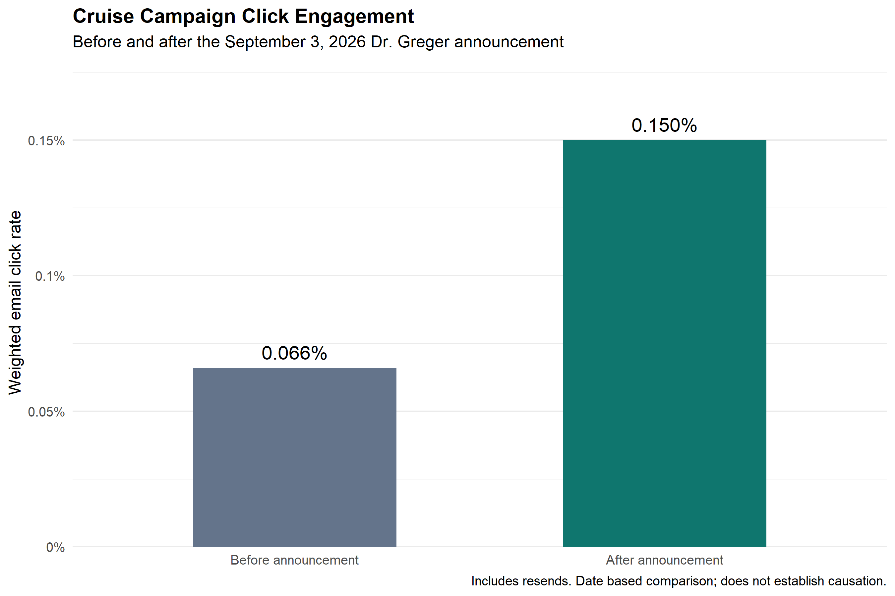
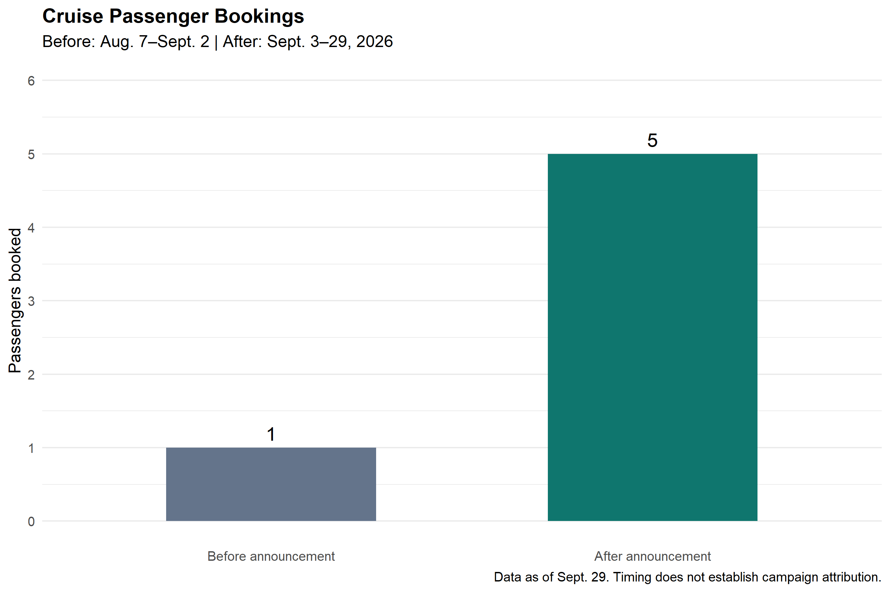

# Health-Optimization-Cruise-Campaign-Analysis
Developed a reproducible R analysis integrating Mailchimp campaign and cruise booking data; cleaned and transformed datasets, calculated weighted engagement metrics, and visualized trends identifying a 126% increase in email click rate following a keynote speaker announcement.
## Campaign Results

### Email Click Rates

### Cruise Passenger Bookings

